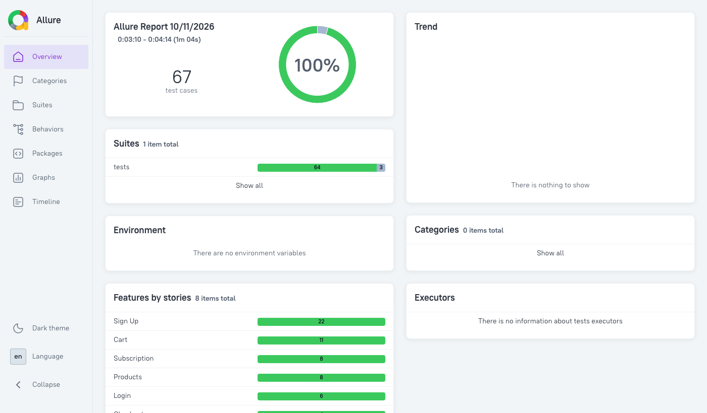
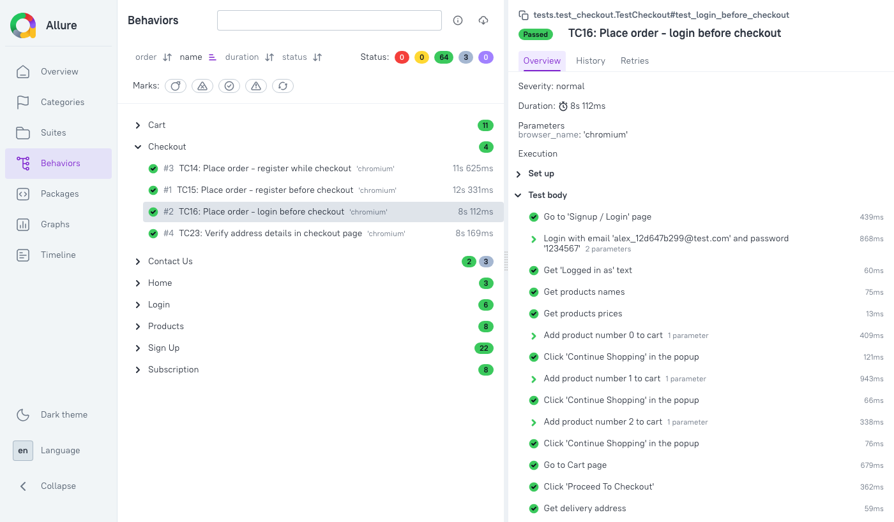

# Shopguard automation

[](https://github.com/alexzagainov/Shopguard-automation/actions/workflows/tests.yml)

UI test automation for the e-commerce site [automationexercise.com](https://automationexercise.com),
built with **Python, Playwright and pytest** using the **Page Object Model**, with **Allure** reports and **GitHub Actions** CI.

**[View the latest test report →](https://alexzagainov.github.io/Shopguard-automation/)**



## Tech stack

| | |
|---|---|
| Language | Python 3.9 |
| Browser automation | Playwright |
| Test runner | pytest, pytest-playwright, pytest-xdist (parallel runs) |
| Reporting | Allure (steps, titles, screenshots on failure) |
| CI | GitHub Actions - runs on every pull request, publishes the report from `main` to GitHub Pages |

## Test coverage

24 of the site's official [test cases](https://automationexercise.com/test_cases) (all except TC4 logout and TC24 invoice download),
plus negative and validation tests - 67 tests in total.

| Area | Test cases |
|---|---|
| Sign up & login | TC1 register user, TC2 login, TC3 wrong email/password, TC5 existing email, form validations |
| Contact Us | TC6 contact form, required-field validations |
| Products | TC8 product details, TC9 search, TC18 categories, TC19 brands, TC21 product review |
| Cart | TC12 add products, TC13 quantity, TC17 remove products, TC20 cart after login, TC22 recommended items |
| Checkout | TC14 register while checkout, TC15 register before checkout, TC16 login before checkout, TC23 address details |
| Subscription | TC10 home page, TC11 cart page, email validations |
| Home | TC7 test cases page, TC25 scroll up with arrow, TC26 scroll up without arrow |

Every test step shows in the report:



## Design decisions

- **Page Object Model with components.** Each page class holds only its own locators and actions and never asserts -
  the test decides pass or fail. Parts that appear on many pages (header, footer, sidebar, product list, popups)
  are components, written once.
- **Tests read like the test case.** One test = one user scenario, even when it goes through many pages.
  Steps that repeat between tests (sign up, checkout, payment) are helper methods, not copy-paste.
  Expected results are in the test parameters, not in `if/else` inside the test.
- **No `sleep`.** Every wait is for something real: a page address, an element, a row disappearing from the cart.
- **Independent tests.** Every user gets a unique email, so tests don't depend on each other and run in parallel.
  A `registered_user` fixture creates a user through the site's API and deletes it after the test, even if the test fails.
- **Stable on a real, noisy site.** Ads are blocked (they slow pages and cover buttons). The recommended-items carousel
  is stopped with a mouse hover before clicking. The payment success message, shown only while the page is leaving,
  is caught by a listener inside the page.
- **Test data as models.** `User` and `ContactForm` dataclasses with valid defaults - a test changes only the field it cares about.

## Known bug found

The Contact Us form is sent even when **name**, **subject** or **message** is empty - only email is required.
These 3 tests are marked `xfail` with the reason, so the build stays green but the report shows the bug.
They are `strict`: if the site fixes it, the tests turn red so the mark can be removed.

## Project structure

```
pages/              page objects - one class per page: its locators and actions, no asserts
pages/components/   parts that appear on several pages: header, footer, sidebar, products list, popups
models/             test data: User, ContactForm
tests/              the tests, one file per feature
tests/base_test.py  creates the page objects before every test
tests/conftest.py   browser settings, ad blocking, Allure screenshot on failure, registered_user fixture
```

## Setup

```bash
python3 -m venv .venv
source .venv/bin/activate
pip install -r requirements.txt
playwright install chromium
```

For the report, install the Allure command line tool: `brew install allure`.

## Running tests

```bash
pytest tests                                   # all tests
pytest tests/test_checkout.py                  # one file
pytest tests -k test_login_before_checkout     # one test
pytest tests -n 4                              # 4 tests in parallel
pytest tests --headed                          # watch the browser, filled fields are highlighted
```

The site address is `--base-url` in `pytest.ini`. To run against another environment, add `--base-url https://...` to the command.

## Allure report

```bash
pytest tests --alluredir=allure-results --clean-alluredir
allure serve allure-results
```

Failed tests have a screenshot and the page address attached in the report.

## CI

GitHub Actions (`.github/workflows/tests.yml`) runs all tests on every pull request and push to `main`.
On `main`, it also builds the Allure report and publishes it to
[GitHub Pages](https://alexzagainov.github.io/Shopguard-automation/).
The results and the screenshots of failed tests are also uploaded as artifacts of each run.
